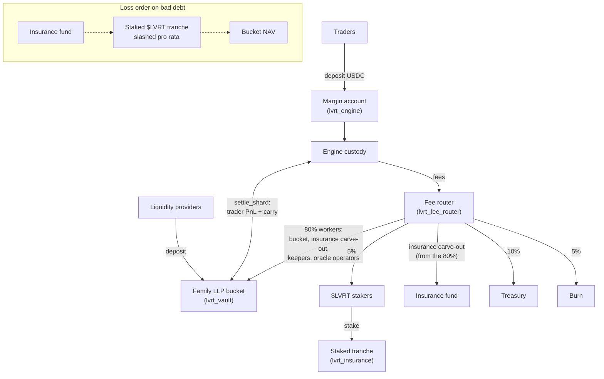
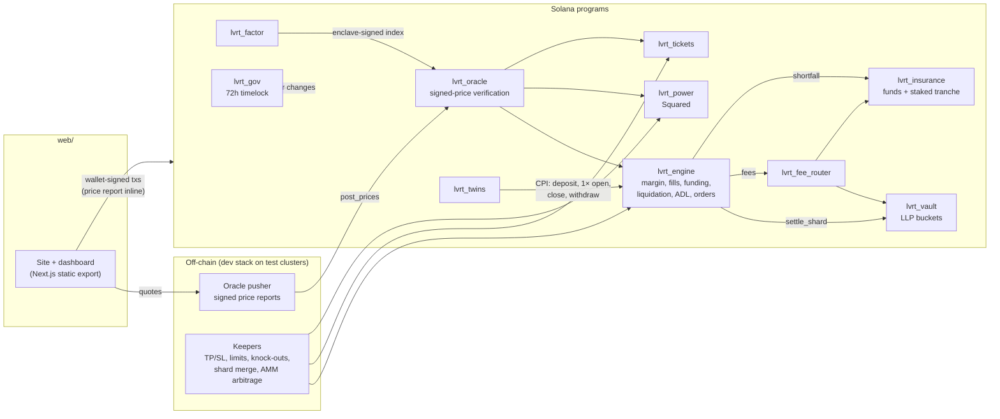

<div align="center">


# Leveret

### Every price. One account.

Every way to trade a price, on one Solana margin account.

[](https://solana.com/)
[](https://www.anchor-lang.com/)
[](rust-toolchain.toml)
[](web/package.json)
[](#testing)
[](https://leveret.net/dashboard/)
[](#disclaimer)

[Website](https://leveret.net) · [Dashboard](https://leveret.net/dashboard/) · [Protocol](https://leveret.net/protocol/) · [Docs](#documentation)

</div>

<p align="center">
  
</p>

> [!IMPORTANT]
> **Devnet only, unaudited.** Leveret runs on Solana devnet with test USDC and no real funds. It is a first
> build pass of the protocol spec: the trading paths are implemented and tested, but the programs have not been
> audited, and some surfaces are still marked `TODO` (see [Roadmap](#roadmap)).

## What is Leveret

Leveret puts seven ways of trading a price behind **one USDC account** on Solana: crypto, US stocks, small caps,
squared exposure, factor baskets, knock-out tickets and stock twins. Every fill is priced by a **signed oracle
report verified inside the same transaction**, and each family has its own liquidity and insurance bucket, so
risk in one never spills into another.

| Family | What you trade | On devnet |
|---|---|---|
| **Core** | Majors and liquid alts, cross or isolated margin | SOL, BTC, ETH, HYPE |
| **Stocks** | US equities and ETFs with session-aware risk (tighter off-hours, last close when closed) | NVDA, TSLA, SPY, QQQ, COIN |
| **Factors** | Rules-based baskets priced by an attested enclave | TRND, STDY, AIB, QLTY |
| **Squared** | Price-squared exposure: PowerTokens from a QuoteAMM, shorts from a ShortVault | NVDA², SPY², SOL² |
| **Tickets** | Knock-out tickets: the price paid is the maximum loss | NVDA-T, SOL-T |
| **Twins** | Wallet tokens that track a stock 1:1 through a 1× perp position | lNVDA, lTSLA, lSPY, lQQQ, lCOIN, lSOL |
| **Small Caps** | Micro-cap perps priced by an enclave, gated by feed depth | Listing gates only |

**How it works**

1. **Deposit once.** USDC goes into a margin account on `lvrt_engine`; Core, Stocks and Factors perps trade
   against it, cross or isolated. Squared, Tickets and Twins pay from the same wallet's USDC.
2. **Trade on a verified price.** Each transaction carries the oracle's Ed25519-signed price report, which
   `lvrt_oracle` verifies before the trade. The fill is bounded by your slippage limit, or nothing executes.
   Market, limit, take-profit and stop-loss orders all run through the same fill path.
3. **Stay within your rules.** Leverage, open-interest and session limits are enforced on-chain. Agents can
   trade for you as delegates with per-order and daily budgets, never with withdrawal rights, and one signature
   revokes them all.
4. **Settle per family.** Trades move internal balances; a permissionless crank (`settle_shard`) moves the
   real USDC between custody and that family's liquidity bucket. Fees go to the fee router.
5. **Losses have an order.** A shortfall is covered by the family's insurance fund, then by the staked $LVRT
   tranche (slashed pro rata), and only then by the bucket's liquidity providers. Withdrawals and exits are
   never blocked by a pause.

### Capital and fee flow



### Architecture



Prices are **pulled, not pushed**: every trade carries its own signed report, so an idle market costs nothing
and a trade never waits on a pusher. Background posting is only needed for marks, liquidations and keepers.

## Live devnet

| | |
|---|---|
| Website | https://leveret.net |
| Dashboard | https://leveret.net/dashboard/ |
| Signed-quote API | https://leveret.net/api/quotes |
| Cluster | Solana devnet, test USDC `H3tRv17bsBR3ccV5cT9nzt66uqm1wn66tT9rmAiAvrfi` |
| Upgrade authority | `2FmzTtbkyfsrqgZ6jhLaTYmKVSyLQvzH52tR76MQzukG` |

Connect a Solana wallet (Phantom, Solflare or Backpack) set to devnet, then use **Get test USDC** on the
portfolio page.

| Program | Address | Devnet |
|---|---|---|
| `lvrt_oracle` | `CFG1eAfxM49c4wAtL2xuorZkH1SB1cHdG8gJyGQUo2P8` | Deployed |
| `lvrt_engine` | `DDwLPMgoXWAnCpDHYp1jSNg5bzW2mAJTvioqZHhyE3gD` | Deployed |
| `lvrt_vault` | `AdFxcb9gcQTPKFo5MyU7MK5M18orENK4ZNfd7vWBKh3h` | Deployed |
| `lvrt_insurance` | `DwkxsoEc8sQBBqBovGsHBDvrmomdcPqy9aK2zFcUZxhQ` | Deployed |
| `lvrt_fee_router` | `GxQSsXZi4uYAieZWyMBvk8c7dBbkKUQWJ5CoHKUHUeQF` | Deployed |
| `lvrt_power` | `ASwWQnPCrBMHryngMVhVzQTy4g5qeHena8kbDs3Z27N3` | Deployed |
| `lvrt_tickets` | `38GVDZJaTDb28E8uwcYt23TjfdKESci4i7t1ywbQJVnM` | Deployed |
| `lvrt_twins` | `7Q2Rsett1NBhw6SY2iFMNZbFznoXfkW2msJ3pjJPuzXC` | Deployed |
| `lvrt_factor` | `3JWHCTuGFfP84R6waHT1ojGCa27TeAVM6WQmsJzZjpx9` | Built and tested, not deployed |
| `lvrt_gov` | `2CvejCR36zZzmKgtBBP6G9jpVQCwwZ1AUe355t1Bci2E` | Built and tested, not deployed |

Stock underlyings are closed at weekends (short mints and stock twin mints pause, exits never do), so SOL²,
SOL-T and lSOL are listed to keep every family tradable around the clock.

## Repository layout

| Path | Purpose |
|---|---|
| [`programs/`](programs) | The 10 Anchor programs (Anchor 1.1.2): oracle, engine, vault, insurance, fee router, power, tickets, twins, factor, gov |
| [`crates/lvrt_math`](crates/lvrt_math) | Pure fixed-point math with no Solana dependencies: oracle aggregation, fill price and skew premium, funding, borrow, margin, liquidation, power index, tickets, NAV, fee split |
| [`crates/lvrt_common`](crates/lvrt_common) | Shared on-chain types: seeds, families, sessions, Ed25519 introspection and the signed `PriceMsg`, upgrade-authority guard |
| [`tests/`](tests) | LiteSVM harness and integration tests for every program |
| [`web/`](web) | Website and dashboard (Next.js 16, React 19, `@solana/kit`, Codama clients generated from the IDLs) |
| [`web/dev/`](web/dev) | Test-cluster stack: idempotent bootstrap, dev oracle (signed quotes, faucet, keepers, AMM arbitrage), end-to-end scripts |
| [`scripts/`](scripts) | WSL build (`wsl-build.sh`), local validator, devnet deploy |
| [`scripts/vps/`](scripts/vps) | Server install, site-only and oracle-only deploys, nginx configs |
| [`docs/`](docs) | [Implementation notes](docs/IMPLEMENTATION.md): per-program status, design decisions, test coverage |

## Quick start (localnet)

Programs build in WSL (Ubuntu 24.04) with Anchor 1.1.2 and Agave 3.1; the dev stack runs on Node 24.

```bash
# in WSL: build the test-cluster programs and start a validator with all of them
scripts/wsl-build.sh devnet
scripts/localnet.sh                               # runs in the foreground; use a second terminal below

# anywhere with Node >= 24
cd web && npm ci && npm run codegen && cd ..
LVRT_CLUSTER=localnet node web/dev/bootstrap.ts   # mints, feeds, markets, buckets, AMMs, twins
LVRT_CLUSTER=localnet node web/dev/oracle.ts      # signed quotes, faucet, keepers
NEXT_PUBLIC_CLUSTER=localnet NEXT_PUBLIC_LIMIT_ORDERS=1 npm --prefix web run build && npm --prefix web run preview
```

Test-cluster builds use `--features devnet`, which swaps the USDC mint for a Leveret test mint so the faucet can
mint; mainnet builds never include it. Full procedures: [docs/IMPLEMENTATION.md](docs/IMPLEMENTATION.md#test-clusters).

## Testing

```bash
scripts/wsl-build.sh test                         # SBF build, then math unit tests + LiteSVM suite
LVRT_CLUSTER=localnet node web/dev/e2e.ts         # deposit, open, close, withdraw
LVRT_CLUSTER=localnet node web/dev/e2e-products.ts  # Squared, Tickets, Twins round trips
LVRT_CLUSTER=localnet node web/dev/e2e-limit.ts   # limit order reserve, cancel, keeper fill
```

**102 tests pass**: 56 math unit tests and 46 LiteSVM integration tests covering the one-transaction fill path,
oracle source rules, liquidation, the loss waterfall and settlement invariants (custody equals the sum of trader
ledgers after every settlement), ADL, staked-tranche slashing, fee routing, the QuoteAMM band, ShortVault ratios,
knock-out evidence, twin backing and limit orders. The end-to-end scripts run against devnet and the live oracle
as well. Every test is listed in [docs/IMPLEMENTATION.md](docs/IMPLEMENTATION.md#what-the-tests-cover).

## Security

- **Not audited.** This is a first build pass; two independent audits are a launch gate in the spec. Do not
  deploy it with real funds.
- **Exits are never paused.** Withdrawals, closes and twin redemptions have no pause gate; the guardian can only
  tighten risk parameters, never loosen them.
- **Prices are verified on-chain.** Every price-dependent instruction reads a report signed by a registered
  oracle key and checked through Ed25519 introspection in the same transaction, with freshness and source rules.
- **Governance changes wait 72 hours** by design: parameter changes and upgrades queue through `lvrt_gov`. On
  devnet `lvrt_gov` is not deployed yet and the deployer key is still the authority.

## Roadmap

| Phase | Scope | Status |
|---|---|---|
| 1 | All 10 programs: trading paths, settlement, ADL, insurance tranche, fee routing | Done |
| 2 | Squared, Tickets, Twins and limit orders end to end, dashboard wired, live on devnet | Done |
| 3 | Remaining `TODO`s: Crab vault, Twin dividend and holding-fee steps, buy-and-burn, Small Caps listings, ratio markets | Planned |
| 4 | Permissionless keepers paid by bounties; LP-funded AMM inventory | Planned |
| 5 | Two independent audits, verified builds, published signer policy, mainnet timelock rehearsal | Planned |
| 6 | Guarded mainnet launch with low caps | Planned |

## Documentation

| Document | What it covers |
|---|---|
| [docs/IMPLEMENTATION.md](docs/IMPLEMENTATION.md) | Layout, website and dev stack, test clusters, every test, per-program status, design decisions |
| [web/.env.example](web/.env.example) | Dashboard configuration (cluster, RPC, quote API, limit orders) |
| [scripts/vps/install.sh](scripts/vps/install.sh) | Server install: static site releases, dev oracle service, nginx |
| `Leveret Overview.pdf`, `Leveret Backend.pdf` | The product and protocol specs this build follows |

## Disclaimer

Leveret is software; it is not a broker, exchange, fund or investment adviser. The deployment at leveret.net
runs on Solana devnet with test tokens only: nothing on it has monetary value, and no real funds should be sent
to any address shown there. Twins are not shares, carry no voting rights and are not issued by any stock issuer.
The programs have not been audited. Nothing in this repository is an offer, a solicitation or investment advice.
